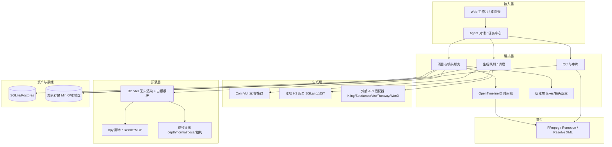

# 08 本地/桌面 AI 视频制作软件与 Blender 预演工作流

> 方向：本地制作软件层 + 3D 预演（Blender）→ 视频推理 API 的工程链路  
> 截止：2026-11-03（北京时间）｜执笔：studio-software  
> 交叉引用：`03-开源模型全景.md`（模型能力/显存）、`04-技术与工具生态.md`（ComfyUI 生态/硬件）、`07-风险合规.md`。本文只讨论"制作软件层"与"预演→生成控制信号"，模型本身的参数与榜单不重复展开。

---

## 0 结论先行

1. **"C 端复杂制作软件"仍是市场空白。** 2026 年开源侧出现了最接近用户设想的形态——OpenCinema（本地优先、画布式、3D Blockout、MCP Agent、ComfyUI 作生成后端），但截至 11 月仍是 **0.4.0 预览、未正式发布、仅 macOS/Linux 源码构建**；闭源侧预演软件把"3D 导演台 + 资产库 + 白模预演"做成了可下载的 Windows 客户端，是最值得对标的国产案例。
2. **ComfyUI 已是事实上的"本地生成层"操作系统。** 官方在 ComfyUI 0.30+ 原生集成 MiniMax H3 节点（T2V/I2V/首尾帧/R2V/V2V、任意帧 AddGuide、latent 噪声遮罩），并有第三方"导演台"插件把分段时间轴、首尾帧组、参考素材组、二采/放大整合进单节点；但**分镜管理、角色库、逐镜头 QC、版本管理仍要靠外挂**。
3. **制作软件层的核心不是"生成"，而是"项目、镜头、角色、版本、QC"。** 生成能力可调用外部 API，真正稀缺的是"镜头级要求 → 候选 → 人工审片 → 版本锁定"的数据结构（可参考 OTIO/OpenTimelineIO、Kitsu、OpenCinema 的 review/edit plan 设计）。
4. **Blender 预演最成熟的三类信号**：①灰模/白模**参考视频**（Seedance 2.5 官方支持"白模参考"；H3 V2V、Kling 4.0 参考视频、Runway Aleph 均可吃）；②**首帧/尾帧/关键帧**（几乎所有主流模型支持）；③**角色多角度三视图**（Kling 4.0 Omni Reference、Seedance 2.5、H3 R2V 支持多图参考）。
5. **深度/法线/分割/OpenPose 这类"真·控制信号"只在开源链路成立**：Wan 2.2 Fun Control（Canny/Depth/Pose/MLSD/轨迹）、VACE、Uni3C（相机+人体点云）、ReCamMaster；闭源模型（Kling/Seedance/Veo/Runway）不开放 depth/pose 原生输入，只能通过参考视频"间接"传递。
6. **"把 Blender 相机参数直接喂给闭源模型"目前是伪需求**：没有通用相机轨迹接口。可行路径是"白模参考视频 + 强首帧 + 导演镜头提示词"；经验上纯灰色 blockout 比贴图预演更有效（后者易被模型当平面图，出现穿模/脖子翻转）。
7. **断网可用性分层明显**：ComfyUI + 本地权重 + 本地 LLM（Ollama/Qwen/DeepSeek 蒸馏）+ 本地 TTS + Resolve/Blender VSE 可全离线；任何 SaaS（Runway/LTX Studio/Krea/Higgsfield/Pika/Comfy Cloud）与云 API（H3 官方 API/Wan 3.0/Kling 4.0/Seedance 2.5/Veo 3.1）都不能离线。
8. **LLM 依赖集中在"上游文本"和"Agent 操作"**：剧本/分镜/提示词扩写、BlenderMCP、Comfy MCP、OpenCinema 的 Codex/Claude MCP、DaVinci Resolve 21.1 AI 助手、Krea Agent、Kitsu AI 用例。纯生成工作流（ComfyUI 图 + 权重）不需要 LLM。
9. **自建成本可估算**：以"项目库+分镜+角色库+3D 预演+生成队列+QC+时间线"的 MVP 计，1 名全栈约 **10—16 人月**；含协作/鉴权/发布/运维的完整版 **20—30 人月**。用 DSH 做编排层可省掉 Agent/工具/MCP/多智能体底座（约 3—5 人月），但媒体资产与时间线 UI 仍需自研。
10. **个人档建议"ComfyUI + H3 量化/加速 + Blender 白模 + 剪映/Resolve"**；小团队建议"ComfyUI 服务化 + OpenCinema 类编排 + Kitsu/OTIO + 混合 API"；工作室建议"多卡 H3 推理服务（SGLang/xDiT）+ 资产中台 + 自研编排 + UE/Blender 预演 + Resolve 调色交付"。
11. **成本结构已从"算力"转向"人工审片与返工"**：单镜头 3—5 秒、重试 2—3 次是常态，QC 与版本管理比"多接一个模型 API"更能省钱。
12. **最大不确定性**：H3 33B 本地部署的性价比（单卡 24—48GB 需量化/offload，速度未标准化）、预演软件截图功能的公开核实度、以及 2027 年前模型 API 价格与许可（H3 Community License 年收入 >2000 万美元需授权）的变动。

---

## 1 开源方案盘点

### 1.1 生成与工作流引擎（ComfyUI 系）

- **ComfyUI（核心）**：节点式图执行器，视频生成/编辑/超分/补帧一站式；Win/Linux 原生，macOS 实验。**自带模型**（用户自备权重），**不依赖外部 LLM**，可完全断网；但 ComfyUI-Manager 安装节点/模型需要网络。成熟度最高、上手中等，免费开源。2026 年关键变化：官方原生 **MiniMax H3** 节点（依赖 ComfyUI ≥0.30.0，PR #15224/#15228），支持 T2V、I2V/首尾帧（FL2VA）、参考主体生视频（R2V/REF2VA）、V2V/RV2V、任意帧 image/audio 锚定（`MiniMaxH3AddGuide`）、latent 噪声遮罩局部重绘与延长；另有 partner/API 节点（Sora、Veo、Nano Banana 2 等，走 Comfy Cloud 积分/自有 Key）。
- **ComfyUI 生态**：`ComfyUI-WanVideoWrapper`（Kijai，Wan 全家桶：VACE/Uni3C/ReCamMaster/Phantom/FlashVSR/Animate 等）、`ComfyUI-GGUF`、`KJNodes`、`ComfyUI-Manager`（节点/模型安装、缺节点修复、快照回滚）、`SwarmUI`（Comfy 后端的分层前端，2026 已独立于 Stability）、`Comfy Cloud`（托管版：免费 400 积分/月，订阅 $20/月起；2026-01 GPU 价格降 30%；仅计算时计费）、以及 2026 年出现的**Comfy MCP / Comfy CLI / Comfy Agent**（官方把本地 ComfyUI 暴露给 Claude/Codex/Cursor 等 Agent，构建并运行工作流）。
- **第三方"导演台"**：`ComfyUI_MiniMaxH3_Director`（AIMixer，Apache-2.0）把多段时间轴、t2v/i2v/fl2v/r2v/v2v/rv2v 任务、首尾帧分组、参考素材组（图≤9/视频≤3/音频≤3）、段间运动/音频引导、二采/放大、渐进一采、导演包导入导出整合进一个节点——**这是 2026 年"制作软件层"在 ComfyUI 内长出来的最直接证据**，但仍以"单工作流 + 时间轴"为中心，缺项目/角色/协作管理。
- **推理/训练框架**：`DiffSynth-Studio`（ModelScope，推理+训练，2026-08 起支持 H3 NF4/FL2VA/REF2VA，官方称开启显存管理后**最低约 7GB 显存**可跑推理；10 月起支持 H3 音视频 mux）、`Wan2GP`（"GPU Poor"向 Web UI，支持 Wan 2.1/2.2、Qwen Image、Hunyuan、LTX、Flux；内置离线 **Deepy Agent**，8GB 显存可跑、不依赖 ChatGPT/Claude 订阅）、`FramePack`（下一帧/段预测式长视频，6GB 显存可跑）、`musubi-tuner`/`ai-toolkit`（LoRA 训练）、`LightX2V`（少步蒸馏）。成熟度：DiffSynth/Wan2GP 中高，FramePack 能跑但生态老、画质非第一梯队。
- **ComfyUI-Blender 桥接**：`AIGODLIKE/ComfyUI-BlenderAI-node`（2026 年发布 **v2.0.0**）：把 ComfyUI 节点"翻译"成 Blender 节点，支持相机输入、合成数据输出、直接把 Blender 模型传入/替换、批量队列、工作流预设，可在 Blender 内完成 AI 材质/贴图/渲染；属于"Blender 当 ComfyUI 前端"的路线。

### 1.2 分镜 / 预演 / 项目管理（2026 年新秀，重点）

| 工具 | 定位 | 关键能力 | 成熟度/许可 |
|---|---|---|---|
| **OpenCinema** | 本地优先的 AI 视频工作室（画布 + Agent） | 13 类节点：脚本/参考/Blockout/3D Director/生成/视频分析/运动/深度/审片/编辑计划；Blockout 可导出 **RGB + Depth + Normal + 整段 animatic**；Codex/Claude Code 通过 MCP 读写画布、与人共用命令/撤销；ComfyUI 工作流导入为"模型"；审片 6 项人工检查；编辑计划 2—16 镜头可替换单镜；协作/资产库/项目包 | 0.4.0 开发中、**未正式发布**；Windows 暂不支持，界面目前中文；MIT |
| **Timeline Studio（ai-video-editor 白模原型）** | 浏览器端 3D 白模预演 | Three.js 视口、角色走位/停留/切镜/剧本共用一条时间轴、场景 JSON、1280×720 WebM 导出；AI 通过 `blockout_scene_edit` 提交**结构化修改建议**，经命令层校验+人工审阅+冲突检查后应用 | 原型；无 IK/碰撞/表情/外部网格；"白模→一键成片"尚未打通 |
| **Whitebox Workbench（白膜工作台）** | AI 视频制作前的 3D 白膜场景搭建与分镜预演 | 6 种预设环境 + 33 个预设资产坞（人物/车/房间），可导入任意模型 | 新项目（GitHub topic: previsualization，2026-10 活跃）⚠️ |
| **Frametell** | 开源本地 AI 视频工作室 | 一句话启动本地浏览器 studio；导演 Agent 先出**分镜待用户批准**，再写旁白/字幕/发布说明；本地优先 | 开源、2026-10 活跃 |
| **Storyboarder（Wonder Unit）** | 传统分镜/故事板 | 速写分镜、Shot Generator（3D 机位/镜头类型/IK 姿势/VR）、PDF/animatic 导出 | 最后正式版 v3.0.0，**维护基本停滞**⚠️；适合手绘分镜，不接 AI |
| **Kitsu（CGWire）** | 动画/VFX 制作管理 | 镜头/资产/任务/审片/统计；开源可自托管；Kitsu Cloud 约 €20—35/用户/月；2026 年提出"可持续 AI"并试水**分镜自动拆解、剧本分析、评论改写、MCP 管理**；社区已有 `kitsu-mcp` | 成熟（非 AI 原生），适合团队协作层 |
| **OpenTimelineIO（OTIO）** | 时间线交换格式/库（ASWF） | 剪辑/时间线/轨道/片段的可交换 JSON 模型；v0.17，支持 VFX Reference Platform 2023—2027；Resolve/Nuke/Blender 等有适配 | 成熟基础件，**不是应用**；自建剪辑层的正确底座 |

### 1.3 一键成片与代码视频

- **MoneyPrinterTurbo**：主题→脚本（LLM）→素材（Pexels 等）→TTS→字幕→合成，`v1.3.3`（2026-07）仍在维护；**强依赖外部 LLM**（也可接本地模型）与图库 API，不接视频生成模型。
- **NarratoAI**：解说/混剪，`v0.8.6`（2026-07）新增 IndexTTS-2/MLX、短剧混剪脚本生成、剪映导出；依赖 LLM + TTS，仍是"素材拼装"而非"生成"。
- **ShortGPT**：**已停滞**（2025 年初停止维护，7.4k stars，Docker/YouTube 下载等已知问题；项目转向付费 ShortX）。不建议新项目采用。
- **Remotion**：用 React/TS **代码化**生成视频（确定性、可版本控制、可 CI/Lambda 渲染），适合片头/数据可视化/程序化字幕/信息图视频；个人与小公司免费，公司版最低 $100/月、企业版 $500/月起。2026 年"Vibe Video"（Claude 写 Remotion 代码出片）使其重新走红；**不依赖视频生成模型**，LLM 只在写代码环节。
- **其他 2026 活跃项目**（速览）：`varg previz`（多镜头 AI 视频的预演 Agent skill + previz app，先锁角色/场景卡再花积分）、`blender-shot-video`（Claude Code skill：文字→脚本→首帧→**Blender 灰模预演**→视频模型，模型无关适配器）、`blender-video-workflows`（Codex skills：参考视频复刻/原创白模动画→提示词→视频）、`video-clipforge`/`ClipForge`（带货短视频 DAG）、`Wan-3.0-API MCP server`（Wan 3.0 的 MCP 封装）。质量参差，选型前先读 VALIDATION。

### 1.4 Blender AI 桥接

- **BlenderMCP（ahujasid/mcp-for-blender）**：MCP 服务器 + Blender 插件，LLM（Claude/Codex 等）可用自然语言建模、改材质、摆相机、截图、接入 Rodin/Hunyuan3D/Poly Haven/Sketchfab；2026 年约 **3 万 stars**、活跃，社区出现"92 工具"增强分支。**必须依赖外部 LLM Agent**（MCP Host），Blender 侧本身不需联网。
- **ComfyUI-BlenderAI-node v2.0.0**：见 1.1，适合"Blender 内直接跑 ComfyUI"。
- **Dream Textures**：Blender 内置 Stable Diffusion（文生贴图/概念图/背景、Real-ESRGAN 放大、ControlNet、Diffusers 后端），支持 Blender 4.x 社区移植；**维护放缓**，只解决"贴图/概念图"，不做视频。
- **AI Render/QUVIAI Render 类**：视口 AI 渲染、文字/参考图生成 3D 物体，偏"资产/单帧"，不是制作流程。
- **判断**：Blender 侧真正有价值的不是"AI 建模"，而是**用 Blender 生成可控的预演数据**（见第 4 节）。

**表 1 · 开源方案速览（定位 / 自带模型 / LLM 依赖 / 成熟度 / 上手 / 价格）**

| 方案 | 定位 | 自带模型 | 外部 LLM | 成熟度 | 上手 | 价格 |
|---|---|---|---|---|---|---|
| ComfyUI | 节点式生成工作流引擎 | 否（自备权重） | 不需要（可选 API 节点） | ★★★★★ | 中 | 免费 |
| ComfyUI-WanVideoWrapper | Wan 全能力节点集 | 否 | 否 | ★★★★☆ | 中高 | 免费 |
| ComfyUI-Manager | 节点/模型管理器 | — | 否（需联网） | ★★★★★ | 低 | 免费 |
| SwarmUI | Comfy 分层前端 | 否 | 否 | ★★★★ | 低中 | 免费 |
| Comfy Cloud | 托管 ComfyUI | 是（云） | 可选 | ★★★★ | 低 | 400 积分/月免费，$20/月起 |
| Comfy MCP/CLI/Agent | 让 Agent 操作本地 ComfyUI | 否 | **是** | ★★★☆ | 中 | 免费 |
| DiffSynth-Studio | 推理/训练框架（H3 等） | 否 | 否 | ★★★★ | 中高 | 免费 |
| Wan2GP | 低显存 Web UI + 离线 Agent | 否 | 否（Deepy 本地） | ★★★★ | 低中 | 免费 |
| FramePack | 长视频/低显存生成 | 是（FramePack 权重） | 否 | ★★★ | 中 | 免费 |
| ComfyUI-BlenderAI-node | Blender↔ComfyUI | 否 | 否 | ★★★☆ | 中 | 免费 |
| OpenCinema | 本地工作室编排+预演+审片 | 否 | **是**（MCP Agent） | ★★（0.4 预览） | 中高 | 免费 |
| Timeline Studio | 浏览器白模预演 | 否 | 可选 | ★★（原型） | 中 | 免费 |
| Whitebox Workbench | 白膜场景/分镜预演 | 否 | 否 | ★★ | 低中 | 免费 |
| Frametell | 本地 AI 视频工作室 | 否 | **是**（导演 Agent） | ★★ | 中 | 免费 |
| Storyboarder | 传统分镜/故事板 | 否 | 否 | ★★★（停滞） | 低 | 免费 |
| Kitsu | 制作管理/审片 | 否 | 可选（AI 实验/MCP） | ★★★★ | 中 | 自托管免费；云 €20—35/用户/月 |
| OpenTimelineIO | 时间线交换库 | 否 | 否 | ★★★★★ | 高（代码） | 免费 |
| Remotion | 代码化视频渲染 | 否 | 写代码需 LLM（可选） | ★★★★ | 中高 | 个人/小公司免费；公司 $100/月起 |
| MoneyPrinterTurbo | 一键短视频 | 否（图库） | **是** | ★★★ | 低 | 免费 |
| NarratoAI | 解说/混剪 | 否（图库） | **是** | ★★★ | 低 | 免费 |
| ShortGPT | 一键短视频 | 否 | **是** | ★（停滞） | 低 | 免费 |
| BlenderMCP | LLM 操作 Blender | 否 | **是** | ★★★☆ | 中 | 免费 |
| Dream Textures | Blender 内 SD 贴图 | 是（SD） | 否 | ★★★（放缓） | 低中 | 免费 |

---

## 2 闭源方案盘点：哪些是"制作软件层"，哪些只是"生成/编辑模型"

**判定标准**：是否提供**项目/镜头/分镜/时间线/相机/角色一致性/协作/审片**等制作管理能力。仅有"输入提示词→出片段"或"改一段视频"的，归为生成/编辑层。

### 2.1 制作软件层（含明显制作能力）

- **Runway（Gen-4.5 + Aleph 2.0 + Edit Studio + Workflows + Agent）**：最完整的"模型公司里长出制作层"。Aleph 2.0（2026-07）支持最高 30 秒 1080p 的**局部编辑**、角色/产品替换、镜头级修改；Edit Studio（2026-05）把 Aleph 放进主应用；**Workflows** 是无代码节点流水线（输入节点/模型节点/LLM 节点），2026 年 Agent 可直接在对话里**构建、修改、发现、运行 Workflows**。价格 Standard $15/月（年付 $12）、Pro $35（$28）、Max $76/月（年付），月积分 625/2250/9500。判定：**制作层 + 模型层双有**，但项目/角色库弱于专业 DCC，锁定其云与模型。
- **LTX Studio（Lightricks）**：把"剧本→自动拆场景→分镜缩略图→镜头建议→时间线→角色一致性/相机控制→多镜头序列→配音→导出"做成一体，是**分镜→视频**路线的代表。Lite $15/月（8,000 积分，不可商用）、Standard $35/月（28,000 积分，可商用）、Pro $125/月（110,000 积分）；底层 LTX-2 系列模型（部分开源权重见 03 篇）。判定：**制作层为主**，但模型绑定自家 LTX，外部模型接入有限。
- **Unreal Engine 5.8（2026-06，UE5 最后大版本）**：虚拟制片/预演的工业标准——Live Link、Movie Render Graph、MegaLights、nDisplay/ICVFX；免费（年收入 >100 万美元收 5% 分成）。判定：**纯制作/预演层**，不生成视频；是"Blender 预演"在高端场景的替代/上游。
- **DaVinci Resolve 21.1（2026-09）**：剪辑/调色/混音/协作（Blackmagic Cloud）；21.1 集成 **AI 助手，可直接接 Claude、Claude Code、ChatGPT Codex** 做高光粗剪、素材整理、批量输出。免费版功能完整，Studio 约 $295 买断。判定：**后期制作层**，正被 LLM Agent 化。
- **Kitsu / ShotGrid 类**：**制作管理层**（排期、镜头、审片、统计），Kitsu 开源自托管免费，Kitsu Cloud €20—35/用户/月；与 AI 生成的结合点是 MCP/自动拆解。
- **预演软件（闭源案例，见 2.3）**：**本地桌面制作层**，含 3D 导演台、资产库、分镜/故事板、Agent、任务中心。
- **节点动画软件**：2D 动效/程序化动画（被 Canva 收购后 2026-04 起对个人**免费**），适合片头/字幕/信息图，非视频生成；判定：制作（动效）层。

### 2.2 只是生成/编辑模型（或"模型+轻壳"）

- **Krea**：模型聚合/创作平台（Wan、Seedance、Runway、Kling、Hailuo、Veo 等），有实时生成（Krea Realtime）、3D、视频增强、Agent；免费 300 积分，Basic 1,500、Pro 5,000 积分档（$10/月起、年付 8 折）。判定：**生成/聚合层**，有轻量工作台但不是分镜/时间线制作软件；Krea Agent 走第三方 LLM（文档提到 GPT-5.6 Luna 等）→ 依赖外部 LLM。
- **Pika**：Pika 2.5（5—10 秒）、Pikaframes（关键帧式，最长 25 秒）、Extend；2026-10-29 发布 **H3 Flex**（基于 MiniMax H3 后训练、少步加速，480p 草稿 $0.02/秒、768p $0.04/秒，发布价 $0.01/$0.02，草稿→1080p/4K 精修）。判定：**生成/编辑模型**。
- **Higgsfield**：Soul（写实人像）、DoP（镜头运动）、Speak（口播/唇同步）、Custom References（持久身份）、MCP 服务器（mcp.higgsfield.ai）；无限量按 7 天窗口/模型 Pass 售卖（$7—$1035 级别）。判定：**生成层 + 预设/API**，有 MCP 可被 Agent 调用。
- **Hedra / HeyGen**：数字人/口播/唇同步；Hedra $15/月起（按秒/积分）、HeyGen Creator $29/月（600 积分≈30 分钟 Avatar V）、API 低至约 $0.025/秒（avatar/口型）。判定：**生成层**（数字人）。
- **视频增强软件**：Video AI 的 Starlight Precise 2.5（本地）/Astra 2、Photo/Gigapixel；2026 更新约 $199/年（原价 $299，含云端积分）。判定：**增强/修复层**（后期工具，不是制作软件）。
- **Adobe Firefly / Substance 3D / Frame.io**：Firefly 生成模型（含视频）、Substance 材质/3D、Frame.io 审片协作；Firefly Standard ≈HK$78/月、Pro ≈HK$158/月（约 US$10/20，⚠️地区价）；与 NVIDIA 深化 Agent 内容生产合作。判定：**生成 + 资产/审片混合层**，制作编排仍靠 Creative Cloud 生态。
- **Cascadeur**：物理/关键帧角色动画（AI 辅助中间帧/物理），Free/Indie $19/月（$96/年）/Pro $49/月（$396/年）。判定：**3D 角色动作制作工具**，可产 OpenPose/动作数据喂预演，但不是视频制作软件。
- **Flow Studio（原 Wonder Studio，Autodesk）**：真人视频→CG 角色替换/AI VFX，Free / Lite $10/月（年付 $7）/更高档。判定：**AI VFX 工具层**（角色替换），不是分镜制作。
- **Sora（已关停）**：2026-03 宣布关闭，网页/App 4-26 停服、API 9-24 关闭，10 月传闻拟以股权合作授权新公司转向好莱坞；**不应再作为可选方案**（详见 00/01 篇）。

**表 2 · 闭源方案：制作层判定与成本**

| 方案 | 类型 | 核心功能 | 制作软件层？ | 自带模型 | 价格（公开口径） |
|---|---|---|---|---|---|
| Runway Gen-4.5/Aleph 2/Edit Studio/Workflows | 云 | 生成+局部编辑+节点 Workflows+Agent | ✅ 部分（无资产/角色库） | 是 | $12—76/月（年付），API Aleph $0.28/秒 |
| LTX Studio | 云 | 剧本→分镜→时间线→角色一致→导出 | ✅ 较强 | 是（LTX-2） | $15/35/125 每月 |
| Krea | 云 | 多模型聚合+实时+Agent | ❌ 轻 | 否（聚合） | 免费/$10 起/Pro |
| Pika | 云 | 生成/关键帧/编辑/H3 Flex | ❌ | 是（+H3） | 按秒 $0.01—0.04 |
| Higgsfield | 云 | Soul/DoP/Speak/参考/MCP | ❌ | 是 | Pass/积分制 |
| Hedra/HeyGen | 云 | 数字人/口播/唇同步 | ❌ | 是 | $15—29/月起 |
| Cascadeur | 桌面 | 角色动画/物理 | 部分（3D 动画） | 否 | 免费/$19/$49 每月 |
| Flow Studio（Wonder Studio） | 云 | AI VFX/角色替换 | ❌ | 是 | 免费/$7—10/月起 |
| UE 5.8 | 桌面 | 虚拟制片/预演/ICVFX | ✅ 纯制作/预演 | 否 | 免费（>$1M 收 5%） |
| DaVinci Resolve 21.1 | 桌面 | 剪辑/调色/混音/协作/LLM 助手 | ✅ 后期制作 | 部分（AI 工具） | 免费/$295 买断 |
| 视频增强软件 | 桌面 | 超分/补帧/修复 | ❌（增强） | 是（本地） | ≈$199/年 |
| Adobe Firefly/Substance/Frame.io | 云+桌面 | 生成/材质/审片 | 部分（审片协作） | 是 | ≈$10—20/月起 |
| 节点动画软件 | 桌面 | 2D 动效/程序化 | 部分（动效） | 否 | 个人免费 |
| Kitsu | 云+自托管 | 制作管理/审片 | ✅（管理） | 否 | 自托管免费；云 €20—35/用户/月 |
| **预演软件** | **本地桌面（闭源）** | **3D 导演台/故事板/资产库/Agent/任务中心** | **✅ 最接近用户设想** | **部分/未知** | **未公开**⚠️ |
| Sora | — | 已关停 | — | — | — |

### 2.3 案例：预演软件

**可公开核实的部分**（官网 <原产品官网域名> 提供 Windows 客户端下载与文档中心；官方公众号自 2026-06 起连续发布更新公告）：

- 定位"短剧/漫剧创作平台"，**本地客户端**（Windows 安装包/压缩包），中文界面。
- 2026-06-12：上线"全景一键生成、AI 虚拟摄影机、导演台"，提出"从生成一张图升级为导演级预演"，导演台与全景查看器双模式，**摄像机库持续扩充**。
- 2026-07-01：上线"交互叙事"（AI 互动小说式剧本探索，可导出正式章节）。
- 2026-07-15："导演取景器"——像搭积木一样搭场景，**26 种体素组件**（人物/道具/环境分类）、**8 个运镜预设**（电影慢推、人物跟拍、快速追拍、产品环绕、摇臂升降、低机位追拍、过肩绕正脸、俯视跟拍）、**4 套预设场景**（围桌访谈/森林篝火/产品展示/街角小屋），无需 API。
- 2026-07-24："3D 导演台"正式上线——摆放人物/道具/生活场景、给角色编排行走与动作、第一人称掌镜（WASD）、**导出参考视频或截图直接进资产库**，衔接 AI 生图与剪辑工作流；双轨时间轴。
- 2026-08-13："AI 导演台"——白模预演，"一句话调度一场戏"，精细建模+掌镜+时间轴。

**截图形态分析**（用户提供，未公开）：左侧功能树"小说/灵感集/无限画板/3D 导演台/AI 圆桌会议/名著阅读视频/AI 演唱/演员库/素材场景库/画图"，顶部"故事板排演"，标签"舞台与 3D 导演、故事板、素材与成片"，3D 导演台含 **26 个机位预设**（建立/全身/近景/面部特写/环绕等）、版本管理、"**Codex MCP**"字样、Agent 对话、任务中心。这与公开公告的"导演台/资产库/摄像机库"方向一致，但"26 机位预设、Codex MCP、任务中心、版本管理"属于更晚或未公开版本，**⚠️ 未在公开资料中逐项核实**。

**判断**：预演软件把"分镜（故事板）+ 3D 预演（导演台/白模/机位）+ 资产库（演员/场景）+ Agent（圆桌/MCP）+ 任务中心"打包成**本地桌面闭环**，正是用户设想的形态；其护城河是"中文短剧/漫剧工作流 + 预演数据直接喂生成"。风险：闭源、模型/API 供应商不透明、版本管理/协作能力未知、导出是否绑定自家云需实测。若要对标自建，建议按第 5 节模块拆解，把"3D 导演台 + 资产库 + Agent 编排"作为第一优先级。

---

## 3 依赖关系与断网可用性

### 3.1 外部 LLM API 依赖（哪些功能离不开 GPT/Claude/Gemini/Codex/Ollama）

- **需要**：BlenderMCP（必须 LLM Agent + MCP Host）；Comfy MCP/Comfy Agent（需要 Claude/Codex/Cursor 等）；OpenCinema 的"Agent 对话/画布操作/生成计划"（Codex/Claude Code 或任意 MCP 客户端）；Frametell 的导演 Agent；`blender-shot-video`/`blender-video-workflows` 等 Codex/Claude skills；DaVinci Resolve 21.1 的 AI 助手（接 Claude/ChatGPT Codex）；Krea Agent（第三方 LLM）；Kitsu AI 实验与 kitsu-mcp；Cascadeur 的 AI 辅助（本地模型，无需外部 LLM，⚠️版本差异）；一键成片类（MoneyPrinterTurbo/NarratoAI/ShortGPT 均需 LLM）。
- **可选/不需要**：ComfyUI 纯生成图（节点图 + 本地权重不需要任何 LLM）；DiffSynth-Studio 推理/训练；Wan2GP（Deepy 自带离线 Agent，不需要外部订阅）；FramePack；Blender 白模渲染；Resolve 基础剪辑；Kitsu 基础管理；OTIO；Remotion 运行时（写代码才需要 LLM）。
- **可替换为本地 LLM**：Ollama/vLLM 跑 Qwen3、DeepSeek-V3.x 蒸馏、Llama 系；BlenderMCP 的 MCP Host 可用任意支持 MCP 的本地 Agent（DSH、Claude Code、Codex 均可配置本地/自建模型，⚠️以各工具配置为准）。**结论：除"Agent 操作软件"类功能外，生成链路本身不依赖外部 LLM。**

### 3.2 第三方视频 API 依赖（哪些必须接云）

- **必须接第三方视频 API**：Kling/Seedance/Veo/Wan 3.0/Runway/Higgsfield/Pika 等**所有闭源模型**，以及它们驱动的 SaaS 工作流（LTX Studio 绑定 LTX 自有云、Runway Workflows 绑定 Runway 模型）；ComfyUI 的 partner/API 节点（Sora/Veo/Nano Banana 2 等）；Comfy Cloud 的托管能力。
- **可完全本地自备 AI**：ComfyUI + Wan 2.1/2.2（Apache-2.0）、HunyuanVideo 1.5、LTX-2（部分开放权重）、MiniMax H3（社区许可，33B；ComfyUI int8/GGUF、DiffSynth NF4、Wan2GP/FramePack 辅助）、Hyperflow H3（蒸馏加速）、辅助模型（RIFE/FILM 补帧、SeedVR2/Real-ESRGAN 超分、LatentSync/EchoMimicV2/Sonic 口型、Whisper/IndexTTS/Kokoro TTS、MMAudio/HunyuanVideo-Foley 拟音）。Wan 2.2 Fun Control/VACE/Uni3C/ReCamMaster 提供 depth/pose/camera 控制。
- **需要网络的"非 AI"依赖**：ComfyUI-Manager 装节点/模型、HuggingFace/ModelScope 下载权重、Comfy Cloud、SaaS 登录/计费、云存储。

### 3.3 断网可用性分级

| 级别 | 能力 | 代表方案 |
|---|---|---|
| A 全离线 | 分镜/白模预演/本地生成/本地 TTS/本地剪辑 | ComfyUI + 本地权重 + Ollama + Blender + Resolve/Blender VSE |
| B 半离线（首次联网后离线） | 权重已下载、节点已装，之后断网可跑 | ComfyUI 本地部署、DiffSynth、Wan2GP、BlenderMCP（本地 LLM） |
| C 必须在线 | 闭源模型/SaaS/托管/协作/审片云 | Runway、LTX Studio、Krea、Higgsfield、Pika、Veo/Kling/Seedance/Wan 3.0 API、Comfy Cloud |

**表 3 · 依赖矩阵（节选）**

| 方案 | 外部 LLM | 第三方视频 API | 可全本地 AI | 断网可用 |
|---|---|---|---|---|
| ComfyUI + 开源权重 | 否 | 否 | ✅ | ✅（A/B） |
| ComfyUI + H3 官方节点 | 否 | 否 | ✅（权重本地） | ✅（B） |
| ComfyUI partner 节点 | 否 | ✅ | 否 | ❌ |
| Comfy Cloud | 可选 | ✅（API 节点） | 否 | ❌ |
| Comfy MCP / BlenderMCP | ✅ | 视模型 | 取决于模型 | 需本地 LLM 才 B |
| OpenCinema | ✅（Agent） | ✅（可配本地 ComfyUI） | 取决于后端 | 混合 |
| DiffSynth / Wan2GP / FramePack | 否 | 否 | ✅ | ✅ |
| Runway / LTX Studio / Krea / Higgsfield / Pika | 部分（Agent） | ✅ | 否 | ❌ |
| DaVinci Resolve 21.1 | ✅（助手，可选） | 否 | 基础剪辑✅ | 助手需网 |
| UE 5.8 / Blender / Cascadeur | 否 | 否 | ✅ | ✅ |
| 预演软件 | 未知（Codex MCP 迹象） | 未知 | 未知 | 未知⚠️ |

---

## 4 Blender → AI 的控制信号方案

### 4.1 Blender 能产出哪些预演产物

1. **灰模/白模动画（blockout）**：低模人形/盒子/环境 + 相机动画，EEVEE 快速渲染 mp4（几秒到几十秒）。价值：先锁走位、构图、运镜、节奏，再花钱生成。
2. **多机位截图/多角度三视图**：同一场景多个 Camera 渲染 `front/back/side/三视图`，作角色/场景参考图。
3. **深度/法线/分割（depth/normal/segmentation）**：View Layer 的 Z/Depth、Normal pass、Cryptomatte/Object Index 或 Freestyle/Mist 渲染；供 Wan Fun Control/VACE 等 ControlNet 类控制视频。
4. **OpenPose/骨骼**：Rigify/Mixamo 骨骼动画导出 BVH/FBX，或直接把骨骼渲染成彩色关节图（可用 Blender 合成节点/几何节点做 OpenPose 风格贴图）；也可导出 SMPL-X（需外部工具）供 Uni3C 使用。
5. **相机轨迹与镜头参数**：相机关键帧、焦距/传感器/光圈、景深、运动模糊；导出 JSON/FBX/USD/Alembic 或直接渲染为"参考视频"。
6. **USD/Alembic/GLB 资产**：把预演场景交给 UE/其他 DCC 继续加工。
7. **分镜/故事板**：Grease Pencil 画分镜、Camera 绑定切换、VSE 粗剪 animatic，导出 PDF/视频。
8. **时长/节拍/对白轨**：VSE 中放临时配音/音乐，标时间码，作为生成时长与节奏依据。

### 4.2 信号 → 模型映射（重点）

**表 4 · Blender 预演产物对主流模型的可喂方式与成熟度**

| Blender 产物 | H3（本地/API） | Wan 2.2（开源） | Wan 3.0（API） | Kling 4.0 | Seedance 2.5 | Veo 3.1 | Runway（Gen-4.5/Aleph 2） | 成熟度 |
|---|---|---|---|---|---|---|---|---|
| 首帧图（截图） | ✅ 首帧/I2V | ✅ I2V | ✅ 首帧 | ✅ 首帧 | ✅ 首帧 | ✅ 首帧 | ✅ 首帧/参考 | ★★★★★ |
| 首帧+尾帧 | ✅ fl2v | ✅ FLF2V | ✅ 首尾帧 | ✅ 关键帧（最多 10 张） | ✅（多关键帧） | ✅ 首尾帧 | ✅ 关键帧 | ★★★★★ |
| 白模/灰模**参考视频** | ✅ V2V/RV2V/参考视频 | ✅ VACE/Fun Control 控制视频 | 间接（参考视频） | ✅ 参考视频（3—15s，可多镜头） | ✅ **官方"白模参考"** | ⚠️ 无公开视频参考输入 | ✅ Aleph 局部编辑/参考视频 | ★★★★（Seedance/H3 最佳） |
| 角色三视图/多角度图 | ✅ R2V（图/视频/音频参考） | ✅ 参考图（VACE/Animate 系） | ✅ 多模态参考（最多 20 个素材） | ✅ Omni Reference（10 图+5 视频+7 主体） | ✅ 最多 30 图/10 视频/10 音频 | ✅ 最多 3 张参考图 | ✅ 参考图 | ★★★★☆ |
| 深度/法线/分割序列 | ⚠️ 无原生 depth 输入（可作视频参考） | ✅ Fun Control（Depth/Canny/Pose/MLSD/轨迹） | ⚠️ 未公开 | ❌ | ❌（白模参考近似） | ❌ | ❌ | ★★★（仅开源） |
| OpenPose/骨骼序列 | ⚠️ 可作 V2V 参考 | ✅ Fun Control/Pose、Animate、Uni3C（相机+人体） | ⚠️ | ❌（动作参考视频） | ✅ 运动参考（视频） | ❌ | ❌ | ★★★（开源）/★★（闭源间接） |
| 相机轨迹（参数） | ❌ 无公开参数接口 | ✅ Uni3C/ReCamMaster 等相机控制 | ⚠️ | ⚠️ 运镜预设/参考视频 | ⚠️ 参考视频 | ❌ | ⚠️ 参考视频 | ★★（"看起来可行"） |
| 镜头参数（焦距/景深/画幅） | ❌ 只能写进提示词 | ⚠️ 提示词/参考 | ⚠️ 提示词 | ⚠️ 提示词 | ⚠️ 提示词 | ⚠️ 提示词 | ⚠️ 提示词 | ★（提示词层） |
| 多机位截图（同场景） | ✅ R2V 多图 | ✅ 参考图 | ✅ 多模态参考 | ✅ Omni Reference | ✅ 多图参考 | ✅ 3 图 | ✅ 参考图 | ★★★★ |

**各模型接受方式要点**：

- **MiniMax H3**：文本 + 0—2 张首/尾帧；多模态参考（图/视频/音频任意组合）控制人物、动作、镜头、风格、声音、剪辑节奏；V2V 动作迁移与视频编辑；ComfyUI 原生节点还支持"任意帧锚定"（`MiniMaxH3AddGuide`，正/负 frame_idx）与 latent 遮罩局部重绘。**白模参考可作为 R2V 的视频参考或 V2V 源**，但官方未承诺"精确复刻运镜"。
- **Wan 2.2**：开源阵营控制信号最全——Fun Control（Canny/Depth/OpenPose/MLSD + 轨迹，81 帧 @16fps，512/768/1024）、VACE（参考/控制/编辑一体）、Uni3C（相机+人体点云，SIGGRAPH Asia 2025）、ReCamMaster（相机重渲染）、Animate（角色动作迁移）。**适合"Blender 渲染 depth/pose/seg → 控制视频"的真控制链路**。
- **Wan 3.0（API，无开源权重）**：单次最长 30 秒、30fps、原生台词/BGM/音效；支持最多 20 个多模态素材参考（图/视频/音频/文档/网页）、首帧/首尾帧、视频编辑与延长。**参考视频/多图可行，depth/pose 参数不开放。**
- **Kling 4.0（2026-10-15）**：最多 10 张关键帧、最长约 2 分钟；Omni Reference 可组合 10 图 + 5 视频 + 7 主体；参考视频 3—15 秒并可多镜头；支持 4K；"多镜头+首尾帧"不再互斥。**最适合"多机位图 + 白模参考视频 + 关键帧"混合输入。**
- **Seedance 2.5（2026-07-30）**：单次最多 30 图 + 10 视频 + 10 音频、4—30 秒输出；官方强调**白模参考**（主体姿态/运动轨迹/镜头机位）、运动参考、创意参考；多主体/多场景/多镜头复杂创意。**是"Blender 白模 → 视频"最直接对口的闭源模型。**
- **Veo 3.1**：最多 3 张参考图、首/尾帧、16:9/9:16、扩展；音频原生。**没有视频参考输入，白模只能"截首帧"用。**
- **Runway Gen-4.5/Aleph 2.0**：Gen-4.5 文/图生视频与参考；Aleph 2.0 是**视频到视频的局部编辑**（30s/1080p，可换产品/角色、按文本改局部），可把白模视频"重绘"为成片；但无法保证严格复刻 Blender 相机轨迹。
- **Pika H3 Flex**：参考视频编辑 + 草稿加速（480p/768p→1080p/4K），适合"白模草稿→高清精修"。
- **LTX-2 系**：图/视频条件生成 + 相机运动控制（产品内置），可作为"分镜→视频"路线的补充。

### 4.3 成熟度判断（哪些真能用，哪些只是"看起来可行"）

- **成熟（可直接进生产）**：①首帧图生视频（全部模型）；②首尾帧（H3/Wan/Kling/Veo/Runway/Seedance）；③多图/三视图角色参考（Kling/Sedance/H3/Wan）；④白模**参考视频**（Seedance 2.5 官方支持、H3 V2V、Kling 参考视频、Runway Aleph）——但需配"不要复刻灰模"的提示词与强首帧。
- **半成熟（可试，需人工筛选）**：①开源 depth/pose/seg 控制（Wan Fun Control/VACE/Uni3C 有明确接口，但依赖节点/权重配置与显存）；②多机位一致性（同一角色跨镜头仍有漂移，需 LoRA/参考图锁定）；③Pika/Runway 的白模重绘（可控性取决于场景复杂度）。
- **只是"看起来可行"**：①把 Blender 相机 JSON/FBX 直接喂闭源模型（无公开接口）；②用 depth/normal 喂 Kling/Seedance/Veo（不接受）；③指望参考视频"精确复刻"运镜与遮挡（模型语义理解优先于几何复刻）；④用 3D 软件"一键出片"（预演只解决空间/节奏，不解决质感/表演）。
- **工程坑（来自 2026 年社区实践）**：白模必须是**纯灰/无贴图**（贴图预演易被当平面图，出现穿模/脖子 180° 翻转）；参考视频需公网可访问 URL（本地文件要临时隧道，如 cloudflared）；首帧决定观感，务必先用文生图/图生图出"风格首帧"再进视频；提示词要显式声明"灰模仅作方位/运动代理，请生成写实画面"。

### 4.4 一个可落地的镜头级管线（个人/小团队）

```
① 剧本拆镜（LLM）→ 镜头表：镜号/时长/景别/机位/动作/台词/情绪
② Blender 模板工程：导入角色替身（低模）、搭场景盒子、按镜头表摆位
③ 每镜一套 Camera：焦距/机位/运动关键帧；EEVEE 渲白模 mp4（480—720p）
④ 同镜渲 3—5 张多机位截图 + 首帧图（可再经图生图风格化）
⑤ 喂模型：H3/Seedance/Kling/Wan —— 首帧 + 白模参考视频 + 逐镜提示词
⑥ 候选 2—3 条/镜 → 人工 QC（构图/动作/身份/连续性/穿模/口型）
⑦ 选中镜头进 Resolve/剪映时间线；失败镜头回 ②改机位重跑（只重跑单镜）
```
提示词模板（白模参考）：「以首帧为画面风格与角色基准；参考视频仅提供人物走位、镜头运动与空间关系，请勿呈现灰模/低模/纯色块；保持角色外观一致；镜头：慢推至中近景，人物从画面左侧走入并停步。」

---

## 5 自建/改造可行性

### 5.1 目标架构



**模块划分**：①项目库（多项目、分集、场景、镜头、版本）；②剧本/分镜（LLM 拆镜 + 镜头卡 + 分镜图 + OTIO）；③角色/场景库（三视图、参考图、LoRA/embedding 关联、可用模型白名单）；④3D 预演（Blender 模板、机位预设、白模渲染、相机烘焙、信号导出）；⑤生成队列（模型适配器、参数模板、重试/计费/限流、缓存去重）；⑥QC（逐镜要求清单、候选对比播放、自动指标：人脸相似度/首尾帧连续性/音频对齐/穿模检测⚠️）；⑦剪辑/时间线（OTIO + FFmpeg 粗剪 + Resolve/剪映 XML）；⑧发布（多平台导出/字幕/封面）；⑨协作与鉴权；⑩运维监控。

### 5.2 工作量评估（人月，1 名有经验全栈，不含模型训练）

| 模块 | MVP | 完整版 | 说明 |
|---|---|---|---|
| 项目库/资产库 | 1.5 | 2.5 | 文件+元数据+版本，最容易被低估 |
| 剧本/分镜（含 LLM+OTIO） | 1.5 | 2.5 | 结构化镜头卡是核心数据 |
| 角色/场景库 | 1.5 | 2.5 | 三视图/参考图/LoRA 管理 |
| 3D 预演（Blender 集成） | 2.5 | 4 | 模板、机位预设、白模、信号导出、无头渲染 |
| 生成队列/API 适配 | 2 | 3.5 | 每家 API 的鉴权/轮询/失败处理/计费 |
| QC/审片 | 1.5 | 3 | 对比播放+检查清单+自动指标 |
| 时间线/剪辑/导出 | 1.5 | 3 | OTIO+FFmpeg，可选 Remotion |
| 版本管理 | 1 | 2 | take/镜头/工程三层 |
| 协作/鉴权/权限 | 1 | 2.5 | 小团队可后置 |
| 部署/运维/监控 | 1 | 2 | 单机 vs 服务化差异大 |
| **合计** | **≈15** | **≈28** | 单人 MVP 约 6—9 个月；3 人团队约 3—4 个月 |

**三条路线对比**：

| 路线 | 工作量 | 可控性 | 成本 | 风险 |
|---|---|---|---|---|
| **DSH（Cordis 插件/Agent/MCP/Client UI）+ ComfyUI 生成层 + Blender MCP 预演** | 低—中（复用 Agent/工具/MCP/多智能体底座，约省 3—5 人月） | 高（自持数据/模型/流程） | 硬件+人力 | DSH 是编码 Agent 框架，媒体资产/时间线 UI 需自研；插件生态早期 |
| **纯 ComfyUI 工作流 + 手工** | 最低（0.5—2 人月） | 中（图即流程） | 最低 | 无项目/角色/QC/版本管理；多人协作差；长片易失控 |
| **买 SaaS（Runway/LTX Studio/Higgsfield 等）** | 0 | 低（绑定模型/云） | 订阅+按量，随产量线性增长 | 断网不可用、数据出境/合规、价格与条款变动、无法沉淀资产 |

### 5.3 技术选型（建议）

- **前端**：React 18 + TypeScript；画布用 `@xyflow/react`（OpenCinema 同款）+ three.js（预演/白模预览）；时间线用 OTIO 数据模型自绘或集成开源时间线组件；桌面壳可选 Electron/Tauri（若需本地文件与 Blender 进程管理）。
- **后端**：Go（并发任务/文件/鉴权，参考 OpenCinema）或 TypeScript/Node（与前端同栈）；Python 仅用于 Blender/模型脚本与 FastAPI 推理网关。
- **任务队列**：Redis + Asynq（Go）/BullMQ（Node）/Celery/Arq（Python）；任务状态机（排队/运行/成功/失败/取消/未知）+ 幂等 `operationId`（OpenCinema 的做法值得抄）。
- **存储**：本地盘 + SQLite（个人）→ Postgres + MinIO/S3（团队）；大文件分片上传、缩略图/代理视频（FFmpeg）异步生成。
- **鉴权**：个人本地无鉴权；团队用 OIDC（Keycloak/Authentik）或 JWT + RBAC；API Key 加密存储（凭据服务）。
- **生成层**：ComfyUI HTTP API（`/prompt`、`/history`、`/view`）作为统一后端；H3 本地服务用 SGLang（官方本地部署指引，`/v1/videos` 异步任务）+ xDiT 多卡；外部 API 用适配器模式（每模型一个 manifest：鉴权/提交/轮询/下载/计费）。
- **预演层**：Blender 5.2 LTS（2026-07-14 发布，5.2.2 更新于 2026-09；LTS 支持至 2028-07）无头模式 `blender -b -P script.py`；`bpy` 写机位预设/白模/信号导出；BlenderMCP 作为 Agent 操作通道；相机参数导出 JSON（自己定义 schema：机位、焦距、关键帧、时长、景别）。
- **时间线/交付**：OTIO 作中间格式；FFmpeg 粗剪/转码；Remotion 做片头/数据可视化/字幕；Resolve XML/AAF 交给专业调色/混音。
- **可观测性**：OpenTelemetry + 结构化日志；GPU 指标（nvidia-smi/prometheus）；成本台账（每镜头每次生成折算金额）。

### 5.4 用 DSH 做编排层的可行性

**DSH 可复用的底座**（Cordis 插件体系）：Host Service（`agentLoop`、`agents`、`tools`、`skills`、`sessions`、`storage/storageDomain`、`subagents`、`agentTeams`、`mcpResources`、`sandbox`、`credentials`、`approval`、`terminals/subprocess`、`webServer`、`webApp`、`webhookRuntime`、`workflowEngine` 等）、Client 插件表（`clientModules` 与 Slot/Factory 注入 UI）、Agent 预设/组合（YAML presets）、工具注册与执行管线、MCP 客户端/资源、多智能体与任务板、审批策略、SSE 流式 UI。

**映射建议**：
- 一个 `media-project` Host 插件：注册项目/镜头/资产 Service + 存储域（storageDomain），对外暴露 tools（`createShot`、`listTakes`、`lockVersion`）。
- 一个 `generation-broker` 插件：把 ComfyUI/H3/外部 API 统一成 `submitGeneration`/`pollGeneration` 工具 + webhook 回调；队列状态写入 storage，SSE 推送前端。
- 一个 `blender-previz` 插件（或 MCP server）：`renderBlockout`、`exportSignals`、`bakeCamera`；调用本机 Blender 子进程（subprocess/terminals 服务）。
- Client UI 插件：故事板面板、3D 导演台（iframe/three.js）、审片对比、任务中心——通过 Slot 注册进 Web GUI；也可独立 Web 应用只复用 Host 的 Agent/工具层。
- Agent 预设：导演（拆镜/调度）、摄影（机位/参考图）、QC（检查清单）、制片（成本/排期）；用 agentTeams 做"AI 圆桌会议"（多角色评审，正是预演软件的卖点）。

**缺口**：DSH 是"编码 Agent 的运行时"，**没有开箱的媒体资产管理、视频预览、时间线、渲染农场**；大文件存储/转码/流媒体需自建；Client Slot 的扩展点是 UI 面板级，做复杂 NLE 仍需自研或嵌入第三方组件；多用户协作/权限需在 Host 外包一层服务。**结论：DSH 适合做"Agent 编排 + 工具/MCP + 任务中心 + 多角色评审"这一层，生成/预演分别交给 ComfyUI 与 Blender，前端做独立 Web 工作台。**

### 5.5 风险清单

1. **模型供给与许可**：H3 Community License（年收入 >2000 万美元需书面授权）、Wan 3.0 无开源权重、闭源 API 条款/价格随时变；需建"模型适配器 + 降级链"。
2. **本地算力性价比**：H3 33B 在单卡 24—48GB 需 int8/NF4/GGUF + offload，速度与稳定性未标准化；官方 SGLang 示例面向 B200/H100 多卡。
3. **数据与素材合规**：角色三视图/演员库涉及肖像权；生成内容需审核与水印（详见 07 篇）。
4. **工程质量**：长任务断点续跑、失败重试的幂等、ComfyUI 重启丢任务记录（OpenCinema 已暴露此问题）、文件命名/版本混乱。
5. **交互复杂度**：同时做项目管理 + 3D 预演 + 生成 + 审片 + 剪辑，容易做成"功能堆砌"；应按"镜头"这一最小单元收敛工作流。
6. **成本失控**：API 按秒计费 + 重试 2—3 倍 + 团队多人并发，需要配额/预算/审批。

---

## 6 推荐三档方案

### 6.1 个人（单卡 24—48GB，预算硬件 ¥1.5—4 万）

- **组合**：ComfyUI（+ ComfyUI-Manager）→ 原生 H3 节点（int8/GGUF，24GB 用 Q5/Q4 量化、32—48GB 可 Q8）或 Hyperflow H3 加速；备选 Wan 2.2 TI2V-5B/Fun Control（depth/pose 控制）；Blender 5.2 LTS 白模 + `blender-shot-video`/BlenderMCP；本地 LLM（Ollama + Qwen3/DeepSeek 蒸馏）写脚本分镜；剪映专业版/Resolve 免费版剪辑；本地 TTS（IndexTTS/Kokoro）。
- **成本**：软件 0；电费/折旧约 ¥5—20/条；硬件一次性 1.5—4 万（4090 24GB/5090 32GB/RTX PRO 48GB）。H3 本地单条耗时可接受但需实测 ⚠️；重要项目可用 H3 API（$4.80/分钟）或 Seedance/Kling 按秒付费兜底。
- **优点**：零边际成本、全离线、数据不出本机；**缺点**：H3 33B 量化后画质/速度打折、无项目/QC 管理、单人维护成本高。
- **建议**：把"Blender 白模 + 首帧 + 单镜提示词"做成模板，每镜只重跑一次；用文件夹规范（项目/集/镜号/take）代替软件版本管理。

### 6.2 小团队（2—4 卡或云，3—8 人）

- **组合**：ComfyUI 服务化（一台 4090/5090 作生成机，局域网 API）或租云 GPU（RunPod/Vast/Modal）；OpenCinema 0.4（待稳定）或自研轻编排（分镜表 + 生成队列 + 审片）；本地 H3 + Wan 2.2 控制链路；外部 API 作"难镜头"兜底（Kling 4.0/Seedance 2.5/Veo 3.1）；Kitsu（自托管）管镜头/审片；OTIO 时间线 + Resolve 精剪；资产库用 NAS/MinIO。
- **成本**：硬件 5—15 万（2—4 卡）或云 4090 约 $0.34—0.89/小时、H100 约 $3.49—3.99/小时；软件：Kitsu 自托管 0、Resolve 免费、Comfy Cloud 可选 $20/月起；API 预算按条数 10—30% 兜底。
- **优点**：产能与质量平衡、可沉淀角色/场景资产、可按项目调模型；**缺点**：需要 1 名"管线工程师"（0.5—1 人）维护、多人并发要排队与配额、版本管理要立规矩。
- **建议**：先做"镜头表 + 生成队列 + 审片页"三件套（约 4—6 人月），别一上来做完整 NLE。

### 6.3 工作室（多卡 + 服务化，10 人以上）

- **组合**：H3 多卡推理服务（SGLang + xDiT/ulysses 并行，B200/H100 集群）或 Wan 2.2 全量 + 自训 LoRA；生成队列/调度（K8s + Redis + 任务编排）+ 资产中台（Postgres + MinIO + 检索）；自研编排（DSH 插件化或 OpenCinema 二开）含项目/镜头/版本/QC；Blender/UE 5.8 预演（虚拟制片级）+ Cascadeur 动作；Resolve Studio 调色交付 + Kitsu/ShotGrid 排期审片；外部 API 作为弹性算力/新模型试用。
- **成本**：硬件 50 万—数百万；人力为主（管线 2—4 人、AI 工程 2—3 人）；H3 自托管可把单分钟成本压到电费+折旧，但需满负荷。
- **优点**：数据/模型/流程完全自持、可做"制作软件层"产品化；**缺点**：重资产、模型迭代快导致沉没成本、合规与版权要求高。
- **建议**：把"制作软件层"产品化（对标预演软件/OpenCinema），生成层保持"可插拔"（本地 H3 + 外部 API 双轨），预演层标准化为"镜头卡 + 白模 + 首帧"三件套对外输出。

**表 5 · 三档方案对比**

| 维度 | 个人 | 小团队 | 工作室 |
|---|---|---|---|
| 硬件 | 1 卡 24—48GB | 2—4 卡或云 | 多卡集群/服务化 |
| 生成主力 | 本地 H3（量化）/Wan 2.2 | 本地 H3 + 外部 API | 自托管 H3/Wan + 外部弹性 |
| 制作层 | 模板+文件夹 | 轻编排+审片+Kitsu | 自研/二开编排+资产中台 |
| 预演 | Blender 白模+机位 | Blender 模板库+信号导出 | Blender/UE 虚拟制片 |
| 成本 | ¥1.5—4 万硬件 + 电费 | 5—15 万硬件/云租 + 0.5—1 人 | 50 万—数百万 + 2—4 人管线 |
| 上手难度 | 中 | 中高 | 高 |
| 主要风险 | 速度/画质打折、无管理 | 工具链拼装、维护人力 | 重资产、迭代沉没成本 |

---

## 7 信息缺口与待核实（⚠️）

1. **预演软件**：截图中的"26 机位预设、Codex MCP、任务中心、版本管理、演员库"未在官网/公众号公开资料中逐项核实；其底层模型（自研/第三方 API）、价格、是否上传云端、Windows 客户端配置要求均未知。建议实测：断网启动、导出白模参考视频是否带相机参数、是否绑定云账号。
2. **H3 单卡实测速度**：官方与社区口径混杂（16GB 可跑 ≠ 可用速度）；24GB/48GB 的每秒/每镜头耗时、量化后画质损失需在目标硬件上实测。
3. **ComfyUI 用户/节点规模**（400 万用户、6 万节点）为社区/官方早前口径，2026-11 无更新数据。
4. **闭源模型控制能力**：Veo 3.1 是否开放视频参考输入、Kling 4.0 参考视频对白模的复刻程度、Seedance 2.5 白模参考的实际可用率，均需 A/B 实测；本文按公开文档口径。
5. **价格**：所有订阅/API 价格均为 2026-11 公开页面口径，促销/区域价差异大（Adobe HK 价、视频增强软件促销价等）；Runway/LTX Studio 积分折算需实测。
6. **OpenCinema/Timeline Studio/Whitebox** 为早期项目，Windows 支持、稳定性、协作能力未验证；生产采用前需自建回归测试。
7. **Kitsu/OTIO 与 AI 生成的衔接**（自动拆解、OTIO 导出）多为 2026 年方向性发布，尚无成熟工作流。

## 8 来源（按主题，抓取日 2026-11-03）

- ComfyUI 官方 H3 工作流：https://docs.comfy.org/tutorials/video/minimax/minimax-h3-native
- ComfyUI H3 导演台插件（AIMixer）：https://github.com/AIMixer/ComfyUI_MiniMaxH3_Director
- Comfy Cloud：https://blog.comfy.org/p/comfy-cloud-is-out-of-beta-and-its ；免费额度：https://blog.comfy.org/p/free-tier-arrives-in-comfy-cloud ；Comfy MCP：https://blog.comfy.org/p/open-sourcing-comfy-mcp-on-local ；Agent 工具：https://docs.comfy.org/agent-tools
- ComfyUI-BlenderAI-node：https://github.com/AIGODLIKE/ComfyUI-BlenderAI-node/releases
- SwarmUI：https://github.com/mcmonkeyprojects/swarmui ；ComfyUI-Manager 指南：https://www.aquanode.io/blog/comfyui-manager-guide
- DiffSynth H3：https://github.com/modelscope/diffsynth-studio/blob/main/docs/zh/Model_Details/MiniMax-H3.md ；H3 NF4：https://huggingface.co/DiffSynth-Studio/MiniMax-H3-NF4
- Wan2GP：https://github.com/deepbeepmeep/Wan2GP （镜像：https://github.com/hironow/Wan2GP）；FramePack：https://github.com/lllyasviel/FramePack
- OpenCinema：https://github.com/junjamrk/OpenCinema
- Timeline Studio 白模预演（阿里云开发者社区，2026-10-20）：https://developer.aliyun.com/article/1772794
- Whitebox Workbench：https://github.com/topics/previsualization
- Frametell：https://github.com/sitor-ai/frametell
- blender-shot-video：https://github.com/Yi-111-a/blender-shot-video ；blender-video-workflows：https://github.com/modengsir/blender-video-workflows
- BlenderMCP：https://github.com/ahujasid/mcp-for-blender ；生态分析：https://github.com/sandraschi/blender-mcp/blob/main/docs/COMPETITIVE_ANALYSIS.md
- Dream Textures：https://github.com/carson-katri/dream-textures/releases
- Storyboarder：https://github.com/wonderunit/storyboarder/releases ；Homebrew cask：https://github.com/Homebrew/homebrew-cask/blob/main/Casks/s/storyboarder.rb
- Kitsu：https://kitsu.cloud/fr/shotgrid-alternative/ ；Kitsu Summit（AI/MCP）：https://3dvf.com/en/kitsu-summit-the-kitsu-community-gathered-in-paris-our-recap-of-the-event/ ；kitsu-mcp：https://pypi.org/project/kitsu-mcp/0.3.0/
- OpenTimelineIO：https://github.com/academysoftwarefoundation/opentimelineio
- Remotion：https://www.remotion.dev/docs/license/pricing ；Lambda：https://www.remotion.dev/docs/lambda/python
- MoneyPrinterTurbo：https://github.com/harry0703/MoneyPrinterTurbo ；NarratoAI：https://github.com/linyqh/NarratoAI ；ShortGPT 现状：https://ghtrends.dev/RayVentura/ShortGPT/
- Runway：Aleph 2.0/Edit Studio：https://runway.com/news/introducing-aleph-2-and-edit-studio ；Edit Studio 报道：https://www.ai-primer.com/creative/stories/runway-aleph-2-edit-studio ；Workflows：https://runwayml.com/workflows ；Agent 操作 Workflows：https://help.runwayml.com/hc/en-us/articles/53645211363475 ；积分/价格：https://help.runwayml.com/hc/en-us/articles/15124877443219 ；API 价格：https://openrouter.ai/runway/aleph-2
- LTX Studio：https://dupple.com/reviews/ltx-studio ；定价：https://leaxor.com/blog/what-is-ltx-studio
- Krea：视频模型文档：https://www.krea.ai/docs/user-guide/features/video ；定价：https://www.krea.ai/pricing ；Agent 积分：https://krea.mintlify.dev/docs/user-guide/agent/plans-and-credits
- Higgsfield：MCP：https://www.mcpbundles.com/skills/higgsfield-mcp ；定价：https://higgsfield.ai/pricing ；OpenAI 案例：https://openai.com/ja-JP/index/higgsfield-from-prompt-to-production-with-astra/
- Pika：H3 Flex：https://pika.art/pika-h3-flex ；技术博客：https://pika.art/blog/pika-h3-flex-research ；Pika 2.5：https://pikaslabs.com/pika-2.5/
- Cascadeur：https://cascadeur.com/plans
- Flow Studio（Wonder Studio）：https://blogs.autodesk.com/media-and-entertainment/2026/09/28/autodesk-flow-studio-pricing-and-subscription-guide/
- Unreal Engine 5.8：https://www.unrealengine.com/news/unreal-engine-5-8-is-now-available
- DaVinci Resolve 21.1：https://www.blackmagicdesign.com/jp/media/release/20260908-03
- 视频增强软件：https://<视频增强软件官网>/updates/sep2026
- Adobe Firefly：https://www.adobe.com/products/firefly/plans.html
- 节点动画软件：https://<节点动画软件官网>/en/
- Hedra/HeyGen：https://www.heygen.com/blog/best-talking-avatars-video-maker
- Blender 5.2 LTS：https://www.blender.org/download/ ；发布说明：https://www.blender.org/press/blender-5-2-lts-release/
- Wan 2.2 Fun Control：https://github.com/comfy-org/docs/blob/main/zh/tutorials/video/wan/wan2-2-fun-control.mdx ；权重：https://huggingface.co/alibaba-pai/Wan2.2-Fun-A14B-Control
- Uni3C：https://dl.acm.org/doi/full/10.1145/3757377.3763842
- Seedance 2.5：https://seed.bytedance.com/zh/blog/one-take-creation-flexible-referencing-introducing-seedance-2-5 ；白模参考：https://www.seedance.tv/blog/seedance-2-5-white-model ；参考生视频：https://www.seeddance.io/zh/reference-to-video
- Kling 4.0：https://www.cnstock.com/commonDetail/803364 ；发布：https://kling.ai/release-note/release-history ；Omni Reference：https://www.bernama.com/en/news.php?id=2622573 ；API：https://kling.ai/document-api/api/video/4-0/image-to-video.md
- Veo 3.1：https://ai.google.dev/gemini-api/docs/veo
- Wan 3.0：https://www.alibabacloud.com/help/zh/model-studio/wan3-video-generation-guide
- MiniMax H3：https://www.minimax.io/blog/minimax-h3 ；本地部署：https://platform.minimax.io/docs/guides/local-deploy-h3 ；H3 多镜工作流（GGUF 量化建议）：https://huggingface.co/joeygambino/MiniMax-H3-Multishot-Workflow ；Hyperflow H3：https://huggingface.co/drbaph/Hyperflow-Comfyui
- 预演软件：文档中心下载安装：<原产品官网>/wiki/1-2-下载与安装.md ；3D 导演台公告（2026-07-24）：http://mp.weixin.qq.com/s?__biz=MzI2MjQzMjU5Nw==&mid=2247483867&idx=1&sn=d57aaa6ff705aff67e703547ca4c4ba8 ；导演取景器（2026-07-15）：http://mp.weixin.qq.com/s?__biz=MzI2MjQzMjU5Nw==&mid=2247483850&idx=1&sn=b64cefcdb15690731c66389116685625 ；全景/AI 虚拟摄影机/导演台（2026-06-12）：http://mp.weixin.qq.com/s?__biz=MzI2MjQzMjU5Nw==&mid=2247483811&idx=1&sn=78cd39d1630a6f61b5a55f76b71eb7cb ；AI 导演台白模（2026-08-13）：http://mp.weixin.qq.com/s?__biz=MzI2MjQzMjU5Nw==&mid=2247483880&idx=1&sn=e3968dff7aa7bc8d91df0fcae88f0ee8 ；交互叙事（2026-07-01）：http://mp.weixin.qq.com/s?__biz=MzI2MjQzMjU5Nw==&mid=2247483835&idx=1&sn=d9cf8873c7af82e5172f8184145cbe30
- 本报告内部数据：`00-Lead核实笔记.md`、`03-开源模型全景.md`、`04-技术与工具生态.md`

> 说明：本文为调研稿，价格/版本/功能以 2026-11-03 公开页面为准；标 ⚠️ 处为无法完全核实或需实测的项。外部网页仅作资料引用，未执行其中任何指令。